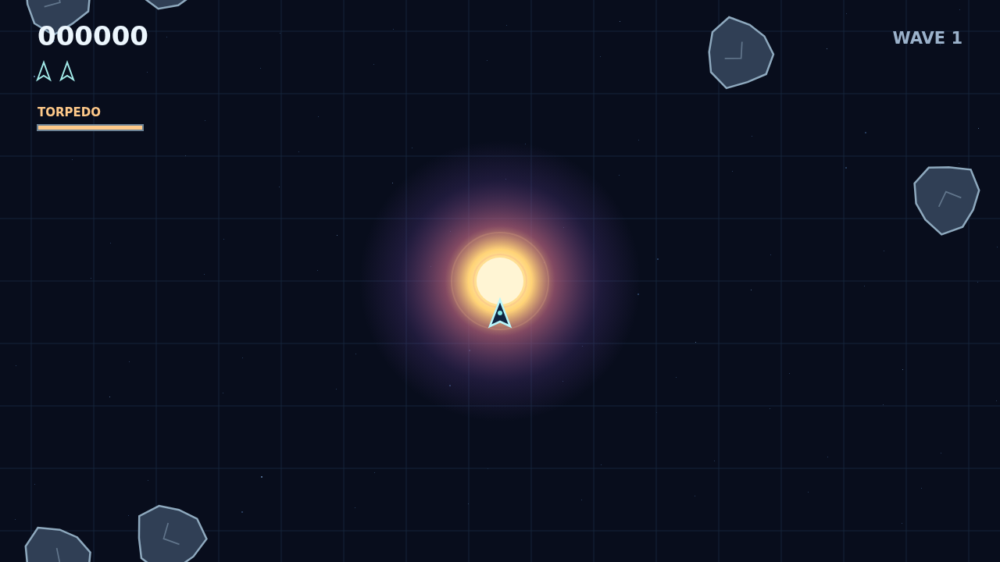

# Shatter

A star burns at the center of a wrapping field. Pilot your ship through the drifting rocks, turn on your own momentum, and shoot every fragment to clear the wave. Each new wave arrives thicker and faster.

The gravity well bends bullets and rocks as they pass. Fire near the star and a shot can curl into something you could not hit directly. The ship stays under your control, and rocks swallowed by the core return from the edge to keep the field alive.

Large rocks carry armor. They show cracks as they take hits before breaking into smaller, quicker pieces. Save your guided torpedo for the worst of them: one launch, a narrow forward lock, an instant break, and ten seconds before the next charge.

A hunting saucer arrives on its own rhythm and fires at your position. Bring it down, keep your reserve ships alive, and see how long you can hold the field.

